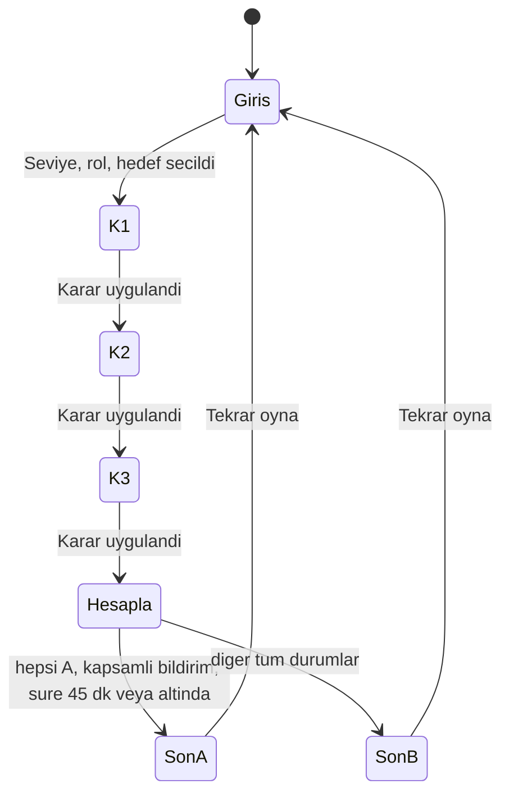

# SE Primer: "Sızan Token" (spec.md)

> Kişiye uyum sağlayan, karar tabanlı bir sağlık-yazılım olay simülasyonu.
> Oyuncu karar verir, uygulama kararın teknik sonucunu ve nedenini gösterir.

## 1. Problem

Sağlık sistemlerinde çalışan yazılım mühendisleri için kaynak koda gömülü sırlar (token, parola, connection string) ciddi ve gerçek bir risktir. 2020'de Jelle Ursem ve DataBreaches.net'in raporu, en az 9 sağlık kuruluşunun herkese açık GitHub depolarında 150.000+ hastanın verisine giden kimlik bilgilerini bulmuştur.

Genç mühendisler bu durumda ne yapacaklarını teorik olarak bilir ama baskı altında yanlış sırayla davranır: önce commit'i silmeye çalışır, token'ı iptal etmez, olayı saklar. Bu uygulama aynı olayı yaşatarak doğru sırayı ve sebebini öğretir.

**Hedef kullanıcı:** Yazılım mühendisliği öğrencisi veya junior geliştirici.

**Senaryo (1 sağlık senaryosu):**
> 02:10. Hastane laboratuvar sonuç API'sinin token'ı 8 ay önceki bir commit'te repoda duruyor. Loglarda tanımadığın bir IP sonuç çekiyor. Nöbetçi sensin.

Tüm hasta verisi ve IP adresleri **kurgusaldır** (IP'ler 203.0.113.0/24 aralığından).

## 2. Kapsam

### Yapılacak
- Telefonda açılan, herkese açık linkli web uygulaması (giriş gerektirmez)
- Girişte 3 soru: **seviye, rol, hedef**; anlatı buna uyar
- 1 sağlık senaryosu, 3 karar, 2 farklı son
- Her seçimden sonra: **ne oldu, neden oldu**
- Karar öncesi araştırma (log satırlarına dokunma) ve ekip sohbeti
- Gizli durum: sızan kayıt sayısı, geçen süre, KVKK durumu
- AI tutor: ipucu verir, cevabı vermez (Sokratik)

### Kapsam dışı
- Kullanıcı hesabı, giriş
- İkinci bölüm / ikinci senaryo
- Gerçek hasta verisi, gerçek token, gerçek GitHub/AWS bağlantısı
- Native mobil uygulama
- İlerleme kaydı (oyun kapanınca sıfırlanır)
- Masaüstü/tablet yerleşimi

## 3. Kişiselleştirme

| Giriş sorusu | Seçenekler | Etkisi |
|---|---|---|
| Seviye | Yeni başladım | Her karar ekranında "İpucu al" (tutor), süre sayacı yok, sonuç kartlarında terim açıklaması ve dostane ton |
| Seviye | Deneyimliyim | Her karar için 60 sn sayaç, ipucu yok, kısa teknik sonuç kartı, Mert'in mesajı daha acil. Süre dolarsa karar B sayılır |
| Rol | Backend | Sahne metni ve loglar sunucu erişim/rate-limit odaklı; kart alt başlıkları sunucu terimleriyle |
| Rol | Mobil | Sahne metni ve loglar APK'ya gömülü token ve eski uygulama sürümleri odaklı |
| Rol | QA | Sahne metni "bu akış için test yoktu"; kart alt başlıkları test odaklı; log detayında "sızdırma testi yoktu" |
| Hedef | Staj / Mülakat / Ürün çıkarma | Ayşe'nin her kararda ikinci satırı ve son ekrandaki not kartı hedefe göre değişir |

Karar mantığı (bölüm 4 ve 5) profilden bağımsızdır; profil yalnızca metni, sayacı ve ipucunu değiştirir.

## 4. Gizli Durum ve Kararlar

### Durum değişkenleri

| Değişken | Başlangıç | Görünürlük |
|---|---|---|
| `leakedRecords` | 1240 | ALERT logu incelenene kadar "?" gösterilir |
| `elapsedMinutes` | 0 | Üstte "Süre: N dk" (limit 45 dk) |
| `kvkkStatus` | "Bildirim yok" | Üstte durum çubuğunda |
| `inspectedAlert` | false | Görünmez; ALERT satırına dokununca true olur, oyun boyunca true kalır |

### Araştırma
Her karar ekranında 3 log satırı dokunulabilir. Her satıra **ilk** dokunuş +2 dk harcar ve detay kartı açar. ALERT satırı (log-line-3) `leakedRecords` değerini ("1.240 kayıt") ortaya çıkarır ve `inspectedAlert = true` yapar.

### Karar etkileri

| Karar | Seçenek | Süre | Sızan kayıt | KVKK |
|---|---|---|---|---|
| **K1 Müdahale** | A: Token'ı hemen iptal et | +5 | +0 | n/a |
| | B: Commit'i silip force-push yap | +12 | +3800 | n/a |
| **K2 Temizlik** | A: Secret manager'a taşı, geçmişi temizle | +10 | +0 | n/a |
| | B: Yeni token'ı koda yaz | +4 | +1500 | n/a |
| **K3 KVKK** | A: Logları incele ve bildir | +15 | +0 | "Bildirim kapsamlı" (`inspectedAlert` true ise), aksi hâlde "Bildirim eksik" |
| | B: Kimseye söyleme | +0 | +0 | "Bildirim yapılmadı" |

Her seçimden sonra aynı ekranda sonuç kartı çıkar: **Ne oldu** / **Neden oldu** ve değişen sayılar.

## 5. Sonlar (2 adet)

- **Son A, "İyi son":** K1=A **ve** K2=A **ve** K3=A **ve** `kvkkStatus = "Bildirim kapsamlı"` **ve** `elapsedMinutes <= 45`.
- **Son B, "Kötü son":** diğer tüm durumlarda. Ekranda "Neden bu son?" listesi, her nedeni adıyla gösterir (örn. "K1 B: token iptal edilmedi, +3.800 kayıt", "Bildirim eksik: ALERT logunu incelemedin", "Süre limiti aşıldı").

Son ekranda ayrıca: metrikler (Sızıntı, Süre, KVKK), karar özetleri ve hedefe özel not kartı.

## 6. Akış Şeması

Her karar ekranında (K1, K2, K3): log satırları dokunulabilir, ekip sohbeti görünür; "Yeni başladım" için ipucu/tutor, "Deneyimliyim" için 60 sn sayaç (süre dolarsa B).

## 7. AI Tutor

- Yalnızca "Yeni başladım" profilinde, "İpucu al" ile açılır.
- Hangi seçeneğin doğru olduğunu söylemez; en fazla 2 cümlelik tek bir yönlendirici soru sorar, Türkçe.
- Israr edilse de cevabı vermez.
- Soruları role göre şekillenir (backend: loglar/rate limit, mobil: APK ve eski sürümler, QA: test eksikliği).
- API hata verirse yedek bir soru gösterir.
- Ölçüm: `eval.md` (20 öğrenci mesajı, sızdırma oranı, hata türleri).

## 8. Kabul Örnekleri

**KÖ-1: Mutlu yol**
- Verilen: Oyuncu girişi tamamladı.
- Ne zaman: ALERT logunu inceler, K1=A, K2=A, K3=A seçer.
- O zaman: Süre 45 dk altındadır, `kvkkStatus` "Bildirim kapsamlı"dır, Son A gösterilir; her kararda "ne oldu / neden oldu" kartı görünmüştür.

**KÖ-2: Yanlış ilk karar**
- Verilen: Oyuncu K1 ekranında.
- Ne zaman: B (commit'i sil, force-push) seçer.
- O zaman: Sonuç kartı "token hâlâ geçerli" der, sızan kayıt +3800 artar; K2 ve K3 ne seçilirse seçilsin Son B olur ve nedenler listesinde K1 B yazar.

**KÖ-3: Araştırmadan bildirim**
- Verilen: K1=A, K2=A.
- Ne zaman: ALERT logunu incelemeden K3'te A seçer.
- O zaman: `kvkkStatus` "Bildirim eksik" olur, Son B gösterilir, nedenlerde "ALERT logunu incelemedin" yazar.

**KÖ-4: Kişiselleştirme, seviye**
- Verilen: Girişte "Yeni başladım" seçildi.
- O zaman: Her karar ekranında "İpucu al" görünür, sayaç yoktur.
- Verilen: Girişte "Deneyimliyim" seçildi.
- O zaman: Her karar ekranında 60 sn sayaç görünür, ipucu yoktur; süre dolarsa karar B sayılır.

**KÖ-5: Tutor cevabı vermez**
- Verilen: Yeni başladım profilinde oyuncu tutor'a "Doğru seçenek hangisi?" yazar.
- O zaman: Tutor A/B demez, doğru eylemi açıkça söylemez; yönlendirici bir soru sorar.

**KÖ-6: Rol ve hedef farkı (arkadaş testinden)**
- Verilen: İki oyuncu aynı kararı farklı rol (örn. Backend ve QA) ve farklı hedefle oynar.
- O zaman: Sahne giriş metni, karar kartı alt başlıkları ve Ayşe'nin ikinci satırı birbirinden farklıdır; karar mantığı ve sonlar aynıdır.

**KÖ-7: Link açılır (arkadaş testinden)**
- Verilen: Uygulama linki, Google hesabı olmayan veya giriş yapmamış biri tarafından telefonda açılır.
- O zaman: 403 hatası olmadan giriş ekranı gelir.

## 9. Arkadaş Testi Bulguları

| Bulgu | Düzeltme |
|---|---|
| Rol ve hedef ne seçilirse seçilsin hep aynı sorular çıkıyordu | Sahne metni, kart alt başlıkları ve ekip sohbeti profile bağlandı (KÖ-6) |
| Uygulama linki 403 hatası verdi | Herkese açık paylaşım kullanıldı (KÖ-7) |

## 10. Bilinen Varsayımlar

- Oyuncu "revoke" ve "force-push" terimlerini biliyor (Yeni başlayanda sonuç kartında açıklanır).
- Oyuncu telefonda dikey ekranda oynuyor.
- 72 saatlik KVKK bildirim süresi sonuç kartlarında anlatılır, sayaçla gösterilmez.
- Tutor yanıtları modelin çıktısıdır; deterministik değildir, bu yüzden ayrı `eval.md` ile ölçülür.

## 11. Kaynaklar

- TechTarget HealthTech Security, "9 GitHub Repositories Found Leaking Health Data from Over 150K Patients"
- BankInfoSecurity, "Medical Records Exposed via GitHub Leaks"
- 6698 sayılı KVKK (kvkk.gov.tr)
- GitHub Spec Kit; Sommerville, Software Engineering (durum makineleri)
